<!-- ══════════════════════════════════════════════════════════════════
     NEON-HUD v2  ·  designed & animated by Siddhant Pardeshi
     theme: cyberpunk telemetry · fonts: JetBrains Mono / Cascadia
     ══════════════════════════════════════════════════════════════════ -->

<div align="center">
  
  <br/><br/>
  <a href="https://git.io/typing-svg"></a>
  <br/><br/>
  <a href="https://linkedin.com/in/siddhant-pardeshi-53788221a"></a>
  <a href="mailto:siddhantpardeshi307@gmail.com"></a>
  <a href="docs/Siddhant_Pardeshi_Resume.pdf"></a>
  
  <br/><br/>
    
</div>

<div align="center"></div>

## ⚡ SYSTEM_OVERVIEW

<table>
<tr>
<td valign="top" width="58%">

```yaml
identity:
  name:    Siddhant Pardeshi
  role:    Software Developer
  seeking: Software Developer · Backend roles
  stack:   [Java 17, Spring Boot, MySQL, AWS, React]
  base:    Pune, Maharashtra, IN
  status:  available-immediately

signal:
  - builds production-style back-ends end-to-end —
    schema → layered REST services → React UI
  - 18+ REST APIs shipped across Spring Boot projects
  - GATE 2025 qualified (Computer Science & IT)
  - B.E. Computer Engineering, SPPU — 8.13/10
    First Class with Distinction
  - NPTEL (IIT Kharagpur) Elite — Programming in Java
  - AWS Cloud Practitioner Essentials certified
  - multi-hackathon veteran (FUSION 2026 · FlytBase · Hacktoberfest)
```

</td>
<td valign="top" width="42%">

**🧭 LIVE TELEMETRY**

`▸ GATE SCORE` — **370 / 1000** · AIR **18571** (170,825 candidates)

`▸ CGPA` — **8.13 / 10** · SPPU

`▸ CERTIFICATIONS` — **12** verified in the vault below

`▸ REST APIs shipped` — **18+** across projects

`▸ CURRENT UPLINK` — IT Vedant · Java Full Stack (in progress)

`▸ CORE MODULES` — DSA · OOP · DBMS · MVC Layered Architecture

<br/>

**⌨️ `git commit -m "ship it 🚀"`**

</td>
</tr>
</table>

<div align="center">
  
</div>

<div align="center"></div>

## ⚔️ TECH_ARSENAL

<div align="center">
  <a href="https://skillicons.dev"></a>
  <br/>
  <a href="https://skillicons.dev"></a>
  <br/><br/>
  <marquee scrollamount="6" behavior="scroll" direction="left" width="88%">
             
  </marquee>
</div>

<div align="center"></div>

## 📊 GITHUB_TELEMETRY

<div align="center">
<table>
<tr>
<td width="33.3%"></td>
<td width="33.3%"></td>
<td width="33.3%"></td>
</tr>
</table>
<br/>

<table>
<tr>
<td width="33.3%"></td>
<td width="33.3%"></td>
<td width="33.3%"></td>
</tr>
</table>
</div>

<div align="center"></div>

## 🚀 FEATURED_MISSIONS

<div align="center">
<table>
<tr>
<td width="50%"><a href="https://github.com/siddhant-pardeshi/BankNest"></a></td>
<td width="50%"><a href="https://github.com/siddhant-pardeshi/BloodDonation-Management"></a></td>
</tr>
</table>
</div>

### ⬢ BankNest — Full-Stack Banking Web Application
`Java 17` `Spring Boot` `Spring Data JPA` `MySQL/H2` `React` `React Router` `Axios` `Bootstrap 5`

- 🔐 Secure registration, login & account management with 8+ RESTful APIs — deposits, withdrawals, fund transfers, transaction history
- ⚛️ `@Transactional` guarantees **atomic, consistent balance updates** across sender & receiver during transfers
- 📊 Responsive React dashboard: live balance view, transaction history, beneficiary management
- 🏗️ Clean layered architecture — Controller → Service → Repository → Entity/DTO

<a href="https://github.com/siddhant-pardeshi/BankNest"></a>

### ⬢ BloodDrop (BloodDonation-Management) — Blood Donation Platform
`Java 17` `Spring Boot` `Spring Data JPA (Hibernate)` `MySQL` `React (Vite)` `React Router` `Axios`

- 🩸 3-tier role-based platform connecting **Donors ↔ Receivers (hospitals) ↔ Admins**
- 🧬 Normalized MySQL schema — Users, Blood Inventory (8 groups), Blood Requests, Donation Camps with enum-based statuses
- ⚙️ Real business rules in Java: **90-day donor eligibility check**, atomic inventory deduction on fulfillment
- 🔄 10+ REST APIs powering `PENDING → APPROVED → FULFILLED` request workflow with role-aware protected dashboards

<a href="https://github.com/siddhant-pardeshi/BloodDonation-Management"></a>

<details>
<summary><b>📁 MORE_DEPLOYMENTS — click to expand</b></summary>
<br/>

| Mission | Description | Tech |
|---|---|---|
| [HospitalShield-AI](https://github.com/siddhant-pardeshi/HospitalShield-AI) | 🏥 Climate-Resilient Hospital Digital Twin — **FUSION 2026 Hackathon** (HC-03 Mayo Clinic track) | Python · AI |
| [asset-intelligence-copilot](https://github.com/siddhant-pardeshi/asset-intelligence-copilot) | 🛢️ AI copilot for oil fields — plain-English Q&A over 600 wells with cited, evidence-backed answers (deterministic FastAPI engine, zero hallucinated numbers) | Python · FastAPI · SQLite |
| [flytbase-ahc-agentic-testing](https://github.com/siddhant-pardeshi/flytbase-ahc-agentic-testing) | 🛩️ Agentic QA for a live drone incident-response dashboard — Playwright multi-user sessions, telemetry observer, vision-LLM screen judging (4/4 mutations caught, 0 false positives) | TypeScript · Playwright |
| [FoodManagement](https://github.com/siddhant-pardeshi/FoodManagement) | 🍱 Role-based food-wastage reduction platform (Donor / Receiver / Admin) | Java · Spring Boot · React |

</details>

<div align="center"></div>

## 🏅 CERTIFICATION_VAULT

<div align="center"><i>actual certificates — click any card to open the original PDF 📄<br/><sub>🔒 privacy: personal identifiers (DOB · registration no. · contact · photo · signatures) are redacted</sub></i></div>
<br/>

<table>
<tr>
<td width="50%" align="center">

[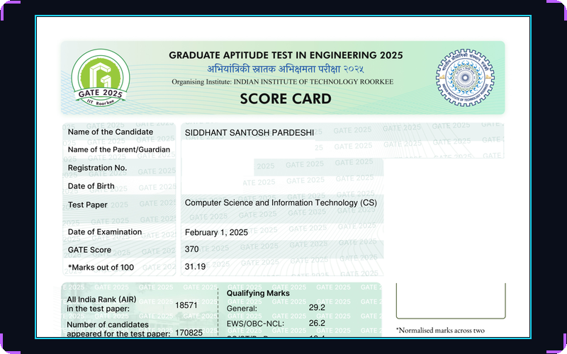](docs/certificates/gate-2025-scorecard.pdf)

**GATE 2025 — QUALIFIED** 🏆
`IIT Roorkee · NCB-GATE · CS & IT` — Score **370** · AIR **18571**
[📄 PDF 🔒 redacted](docs/certificates/gate-2025-scorecard.pdf)

</td>
<td width="50%" align="center">

[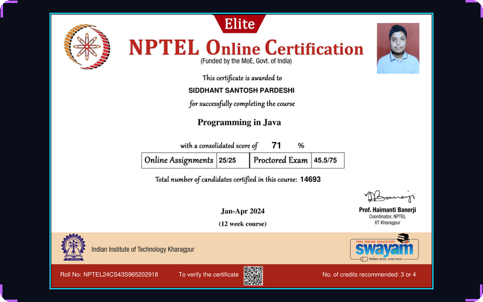](docs/certificates/nptel-programming-in-java.pdf)

**NPTEL Programming in Java — ELITE** 🎖️
`IIT Kharagpur · 12-week · 71% (25/25 assignments)` — Jan–Apr 2024
[📄 PDF](docs/certificates/nptel-programming-in-java.pdf) · [🔗 Verify](https://drive.google.com/file/d/1V1Tzg6wp1lo1I_KfluyhWuTI4X9e8OdT/view?usp=sharing)

</td>
</tr>
<tr>
<td width="50%" align="center">

[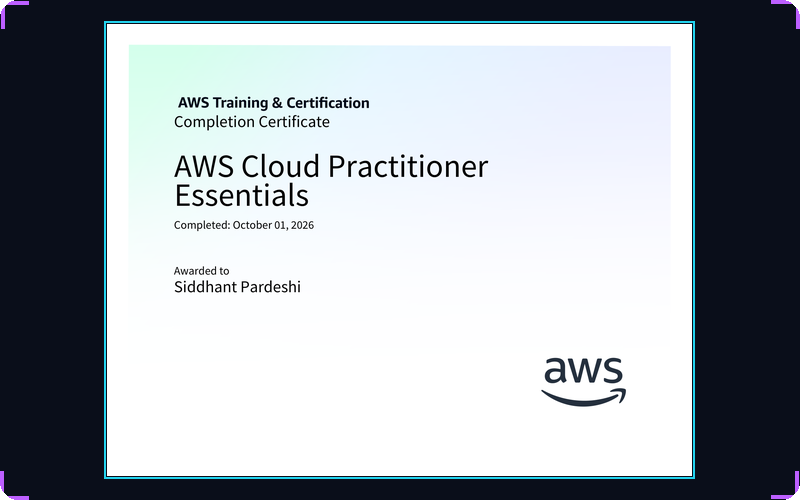](docs/certificates/aws-cloud-practitioner.pdf)

**AWS Cloud Practitioner Essentials** ☁️
`AWS Training & Certification` — Oct 2026
[📄 PDF](docs/certificates/aws-cloud-practitioner.pdf)

</td>
<td width="50%" align="center">

[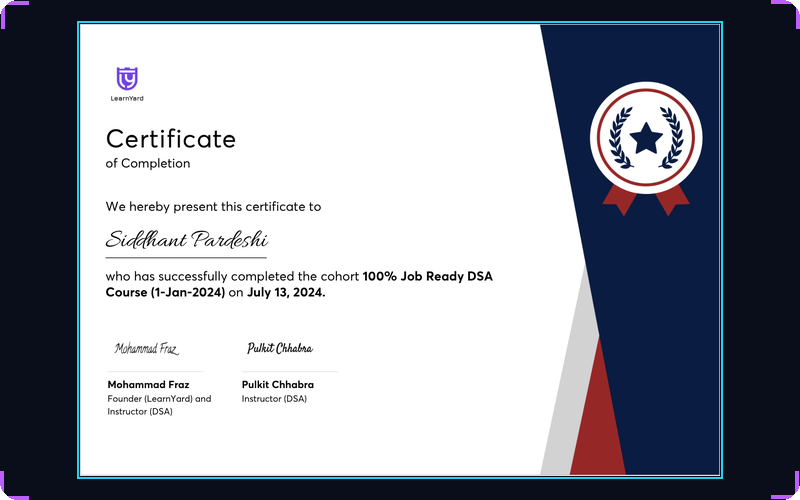](docs/certificates/learnyard-job-ready-dsa.pdf)

**100% Job-Ready DSA Course** 🧮
`LearnYard · Mohammad Fraz & Pulkit Chhabra` — Jul 2024
[📄 PDF](docs/certificates/learnyard-job-ready-dsa.pdf) · [🔗 Verify](https://drive.google.com/file/d/1jeOdPghC7RwZJizlb7fIOtzu11y8DcjJ/view?usp=sharing)

</td>
</tr>
<tr>
<td width="50%" align="center">

[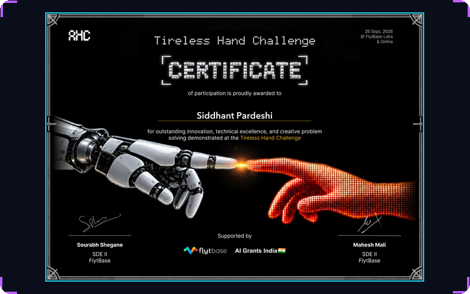](docs/certificates/flytbase-tireless-hand-challenge.pdf)

**FlytBase — Tireless Hand Challenge** 🤖
`Hackathon · FlytBase Labs & Online` — Sept 2026
[📄 PDF](docs/certificates/flytbase-tireless-hand-challenge.pdf)

</td>
<td width="50%" align="center">

[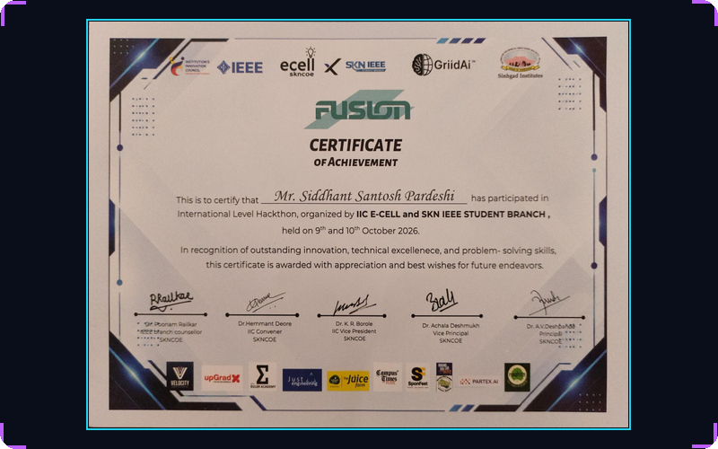](docs/certificates/fusion-2026-hackathon.pdf)

**FUSION 2026 — International Hackathon** 🌐
`IIC E-Cell × SKN IEEE · SKNCOE` — Oct 2026
[📄 PDF](docs/certificates/fusion-2026-hackathon.pdf) · [🔗 Verify](https://drive.google.com/file/d/1R1MUKnUPL81gC5B4HiuOWsSSJCkVcsqt/view?usp=sharing)

</td>
</tr>
<tr>
<td width="50%" align="center">

[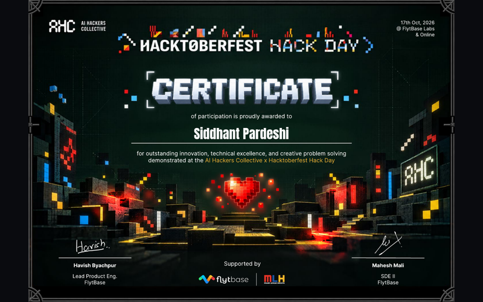](docs/certificates/ahc-hacktoberfest-hack-day.pdf)

**AI Hackers Collective × Hacktoberfest — Hack Day** 🎃
`AI Hackers Collective · supported by FlytBase & MLH` — Oct 2026
[📄 PDF](docs/certificates/ahc-hacktoberfest-hack-day.pdf)

</td>
<td width="50%" align="center">

[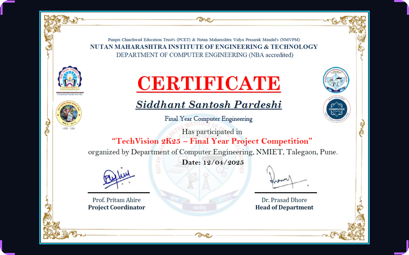](assets/certs/cards/nmiet-techvision-2k25.png)

**TechVision 2K25 — Final Year Project Competition** 🎓
`NMIET, Dept. of Computer Engineering` — Apr 2025

</td>
</tr>
<tr>
<td width="50%" align="center">

[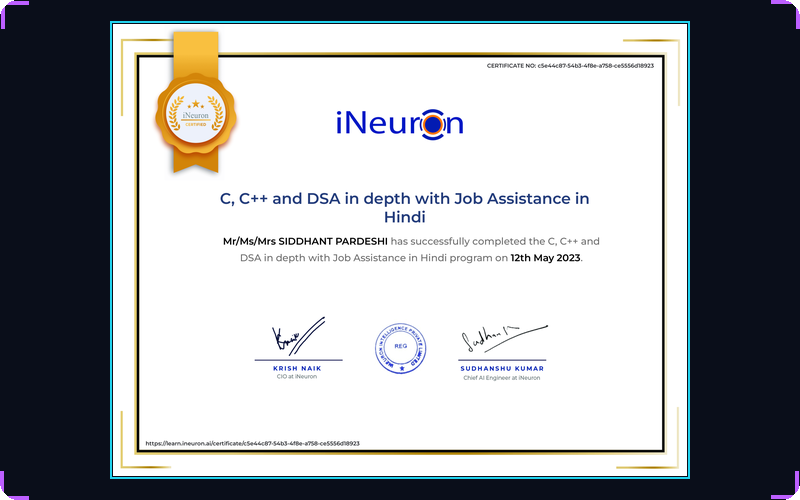](docs/certificates/ineuron-cpp-dsa.pdf)

**C, C++ & DSA in Depth** ⚙️
`iNeuron.ai · with Job Assistance` — May 2023
[📄 PDF](docs/certificates/ineuron-cpp-dsa.pdf) · [🔗 Verify](https://learn.ineuron.ai/certificate/c5e44c87-54b3-4f8e-a758-ce5556d18923)

</td>
<td width="50%" align="center">

[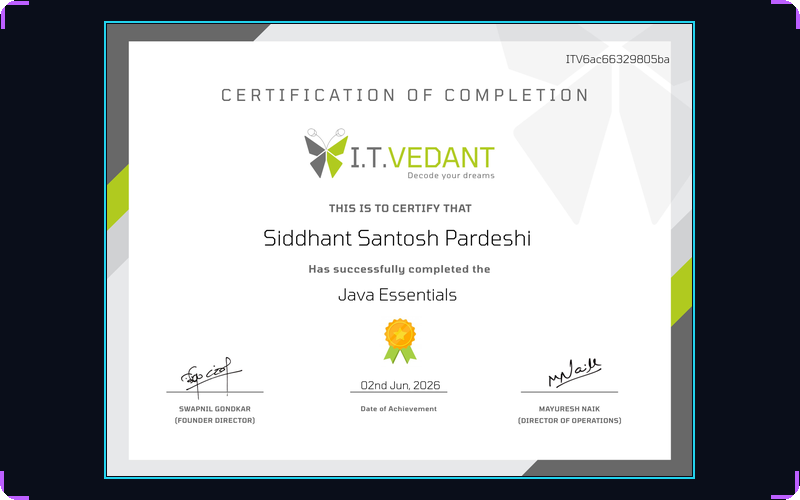](docs/certificates/itvedant-java-essentials.jpg)

**IT Vedant — Java Essentials** ☕
`Certification of Completion` — Jun 2026
[🖼️ Original](docs/certificates/itvedant-java-essentials.jpg)

</td>
</tr>
<tr>
<td width="50%" align="center">

[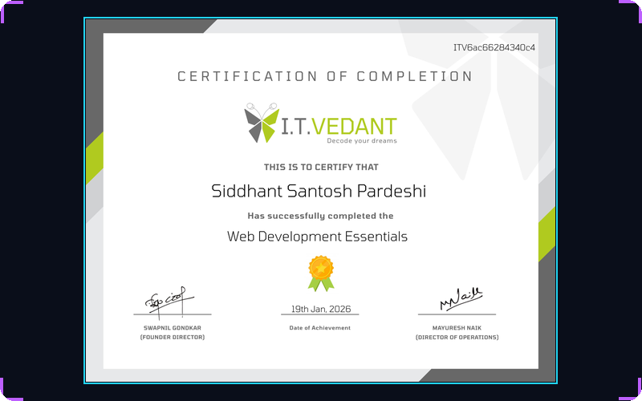](docs/certificates/itvedant-webdev-essentials.jpg)

**IT Vedant — Web Development Essentials** 🕸️
`Certification of Completion` — Jan 2026
[🖼️ Original](docs/certificates/itvedant-webdev-essentials.jpg)

</td>
<td width="50%" align="center">

[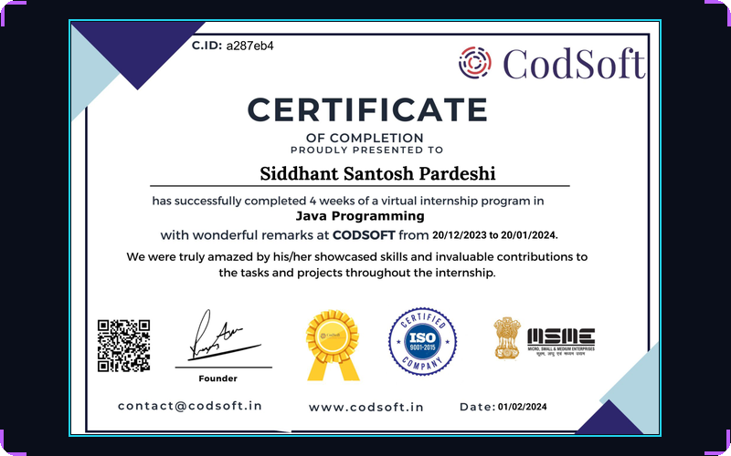](docs/certificates/codsoft-java-internship.pdf)

**Java Programming Internship** 👨‍💻
`CodSoft · 4-week virtual internship` — Jan 2024
[📄 PDF](docs/certificates/codsoft-java-internship.pdf)

</td>
</tr>
</table>

<div align="center">

**📜 STILL VERIFYING IN THE WILD**

[](https://lnkd.in/p/dXfRkyyR)
[-ffd166?style=for-the-badge&logo=coffee&logoColor=white&labelColor=0d1117)](https://www.itvedant.com/)

</div>

<div align="center"></div>

## 🏆 ACHIEVEMENT_LOG

```diff
+ 🥇 GATE 2025 Qualified — Computer Science & IT (Score 370 · AIR 18571)
+ 🌍 FUSION 2026 International Hackathon — Participant, Certificate of Achievement (SKNCOE)
+ 🤖 FlytBase Tireless Hand Challenge — Certificate of Participation (Sept 2026)
+ 🎃 AI Hackers Collective × Hacktoberfest Hack Day — Certificate of Participation (Oct 2026)
+ 🎖️ NPTEL (IIT Kharagpur) — Programming in Java · ELITE · 71% (25/25 assignments)
+ 🧮 DSA x2 — LearnYard 100% Job-Ready · iNeuron C/C++ & DSA in Depth
+ 💰 Vidyadhan Scholarship — selected for Academic Excellence
+ 🎓 TFWS Scheme (Govt. of Maharashtra) — Tuition Fee Waiver, Engineering Admission
+ 📐 NMIET TechVision 2K25 — Final Year Project Competition
```

<div align="center"></div>

## 🐍 SNAKE.EXE — eating my contributions

<div align="center">
<picture>
  <source media="(prefers-color-scheme: dark)" srcset="https://raw.githubusercontent.com/siddhant-pardeshi/siddhant-pardeshi/output/github-contribution-grid-snake-dark.svg"/>
  <source media="(prefers-color-scheme: light)" srcset="https://raw.githubusercontent.com/siddhant-pardeshi/siddhant-pardeshi/output/github-contribution-grid-snake.svg"/>
  
</picture>
</div>

<div align="center"></div>

## 📫 OPEN_CHANNEL

<div align="center">
  <a href="https://linkedin.com/in/siddhant-pardeshi-53788221a"></a>
  <a href="mailto:siddhantpardeshi307@gmail.com"></a>
  <a href="https://github.com/siddhant-pardeshi"></a>
  <a href="docs/Siddhant_Pardeshi_Resume.pdf"></a>
  <br/><br/>
  
  
  <br/><br/>
  ⭐️ Star the repos you find useful — every signal counts.
</div>

<div align="center">
  
</div>

<!-- © 2026 · Siddhant Pardeshi · Neon-HUD v2 -->
